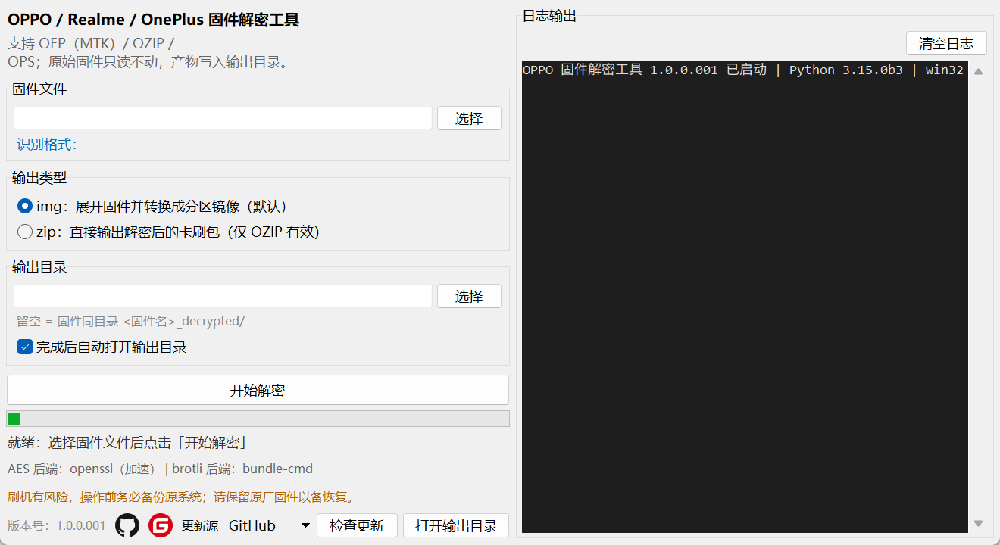

# OPPO 固件解密工具 / OPPO Firmware Decrypt Tool

> 当前版本 / Current version：**1.0.0.001**

> **仓库地址 / Repository：**
> - **GitHub**：https://github.com/LJY-33684/oppo-firmware-decrypt
> - **Gitee 镜像**：预留 `https://gitee.com/Q3368436451/oppo-firmware-decrypt`（尚未创建；界面 Gitee 图标当前指向该预留地址）

## 目录 / Table of Contents

- [项目介绍 / Introduction](#intro)
- [致谢 / Credits](#credits)
- [功能特点 / Features](#features)
- [支持格式 / Supported Formats](#formats)
- [仓库结构 / Repository Layout](#layout)
- [环境要求 / Requirements](#env)
- [图形界面 / GUI](#gui)
- [命令行 / CLI](#cli)
- [输出约定 / Output Rules](#output)
- [解密后端 / Decryption Backends](#backends)
- [单实例与界面细节 / Single Instance & UI](#singleton)
- [更新检查 / Update Check](#update)
- [发行包 / Release Package](#release)
- [已知边界 / Known Limits](#limits)
- [常见问题 / FAQ](#faq)
- [免责声明 / Disclaimer](#disclaimer)
- [版本记录 / Version History](#history)
- [联系 / Contact](#contact)

<a name="intro"></a>
## 项目介绍 / Introduction

本工具从 [mtk-garbage-porttool](https://github.com/LJY-33684/mtk-garbage-porttool-master) 的
OPPO 固件解密模块中抽出，独立成一个只做一件事的工具：**把 OPPO 系官方固件解开，
得到分区镜像或标准卡刷包**。核心解密逻辑与上游保持一致，去掉了移植工具的方案表、
移植条目与设备状态体系，保留 GUI、CLI、随包加速组件与更新检查框架。

支持 **OFP（OPPO MTK）/ OZIP（Realme / OPPO）/ OPS（OnePlus）** 三种格式；
原始固件全程只读，输出目录可自定义，临时文件在输出目录内自动清理。

This tool is extracted from the OPPO firmware decryption module of
[mtk-garbage-porttool](https://github.com/LJY-33684/mtk-garbage-porttool-master).
It does one thing only: decrypt OPPO-family official firmware and produce partition
images or a standard flashable ZIP. It supports **OFP / OZIP / OPS**, provides both
GUI and CLI, and never modifies the source firmware.

<a name="credits"></a>
## 致谢 / Credits

- 解密算法来自 [@bkerler/OPPO_Decrypt_Tools](https://github.com/bkerler/OPPO_Decrypt_Tools)
  （MIT License），经 [@ColdWindScholar/TIK](https://github.com/ColdWindScholar/TIK) 集成，
  再经 mtk-garbage-porttool 合并为三合一模块。
- 单实例锁、更新检查框架与底部风险提示复用了 mtk-garbage-porttool 的实现。
- 内置 OpenSSL 为 1.0.2u Windows x64 构建（Shining Light Productions），
  仅用于 AES 加速；缺失时自动回落到纯 Python `pyaes`。
- 内置 Brotli 二进制与 Python wheel 来自 Google Brotli 官方发布。
- GitHub / Gitee 徽标仅作为界面入口标识，商标归各自所有者。

<a name="features"></a>
## 功能特点 / Features

- **1. 三格式识别 / Three-format detection**
  - 自动识别 `.ofp` / `.ozip` / `.ops`，无需手动选择格式
  - OZIP 支持 PK 型加密包、OPPOENCRYPT 头和明文旧包
  - OFP 按 MTK 分区表导出，OPS 解析尾部 XML 与加密分区

- **2. 两种输出形态 / Two output modes**
  - `img`：展开固件并转换成分区镜像（OFP / OZIP / OPS 通用）
  - `zip`：只重建解密后的卡刷包（仅 OZIP；OFP / OPS 自动按 img 处理）

- **3. 随包组件 / Bundled backends**
  - Windows 自带 `openssl.exe`（AES 加速）与 `brotli.exe`（`.new.dat.br` 解压）
  - openssl 缺失时自动降级 `pyaes`；brotli 缺失时自动回落到 vendored Python 库
  - 无需用户额外安装依赖即可开箱运行

- **4. 图形界面 / GUI**
  - 选固件 → 选输出类型 → 选输出目录 → 开始解密，四步操作
  - Per-Monitor V2 DPI 感知，125% / 150% / 200% 缩放下文字不发糊
  - 后台线程解密 + 队列刷新日志，界面不卡死
  - 完成后可自动打开输出目录

- **5. 单实例保护 / Single-instance guard**
  - 同一源码目录只允许运行一个 GUI 实例
  - 重复启动可跳转至已运行窗口，或清除残留状态锁
  - 进程被强杀留下的锁会自动识别并接管，不再误锁死

- **6. 稳定 CLI / Stable CLI**
  - `decrypt_cli.py` 面向外部 UI 壳，参数 / 日志 / 退出码契约固定
  - stdout 逐行输出，`【解密】/【警告】/【错误】/【完成】/【CLI】` 分类
  - 支持 `--log-file` 双写日志文件

- **7. 界面细节 / UI details**
  - 底部版本号旁提供 GitHub / Gitee 图标，点击用系统浏览器打开
  - 保留移植工具同款橙色刷机风险提示
  - 圆形蒙板窗口图标（多尺寸 ICO，圆外透明）

- **8. 自检 / Self-test**
  - 15 项合成样本自检：AES 双后端、brotli、sdat2img、fsutil、单实例锁、
    格式识别、OZIP/OFP/OPS 解密、CLI 契约、更新未配置行为、GUI 冒烟与端到端

<a name="formats"></a>
## 支持格式 / Supported Formats

| 格式 / Format | 适用设备 / Devices | 识别方式 / Detection | 输出 / Output |
|---|---|---|---|
| **OFP** | OPPO MTK 平台 | 文件头 `MMM` + 分区表结构 | 分区镜像（img） |
| **OZIP** | Realme / OPPO | `OPPOENCRYPT!` 头 / PK 型加密包 / 明文 ZIP | 卡刷包（zip）或分区镜像（img） |
| **OPS** | OnePlus MSM/EDL 包 | 尾部 0x200 头 + XML 索引 | 分区镜像（img） |

> 说明：OFP / OPS 没有“卡刷包”形态，选择 `zip` 时会提示并仍按 `img` 输出。

<a name="layout"></a>
## 仓库结构 / Repository Layout

仓库根目录只放仓库级文件，源码全部在同名子目录内，与 mtk-garbage-porttool 的仓库层级一致。

```text
oppo-firmware-decrypt/
├─ README.md                 本文件（仓库说明）
├─ LICENSE                   GPL-3.0 全文
├─ .gitignore                运行产物 / 缓存忽略规则
├─ latest_version.txt        更新检查版本文件（更新地址暂空）
└─ oppo-firmware-decrypt/    源码本体（发行 zip 的根目录即此目录）
   ├─ main.py                GUI 入口
   ├─ decrypt_cli.py         CLI 入口（外部壳调用）
   ├─ run.bat                Windows 启动脚本（自动挑选带 Tcl/Tk 的 Python）
   ├─ app/                   全部实现与随包资源（一个包收口）
   │  ├─ gui.py              轻量 Tk 界面（Per-Monitor V2 DPI 感知）
   │  ├─ singleton.py        单实例锁（跳转已运行窗口 / 清除残留锁）
   │  ├─ icons/              窗口图标 app.ico/app.png + GitHub / Gitee 图标
   │  ├─ updater.py          更新检查（地址为空，默认关闭）
   │  ├─ common.py           CLI / GUI 共用逻辑
   │  ├─ version.py          版本号唯一真源
   │  ├─ core/               解密核心（OFP / OZIP / OPS、brotli、sdat2img、pyaes）
   │  ├─ bin/win/x86_64/     openssl / brotli 加速组件
   │  ├─ licenses/          OpenSSL / Brotli 许可原文
   │  ├─ tests/selftest.py   合成样本自检（15 项）
   │  └─ tools/              build_zip.py + 获取 openssl/brotli 组件脚本
   ├─ docs/                  INTERFACE.md / THIRD_PARTY_NOTICES.md / 界面截图
   ├─ README.md              使用说明、输出约定、已知边界
   └─ LICENSE                GPL-3.0 全文
```

<a name="env"></a>
## 环境要求 / Requirements

- **Windows x64**：主支持平台，Python 3.10+，需带 Tcl/Tk（官方 Python 默认包含）
- **Linux**：可运行 CLI；需系统自备 `openssl` 与 `brotli`（或 `pip install brotli`）
- 已在 Python 3.15 上完成 15/15 自检；Python 3.13 可运行核心与 CLI，GUI 需完整 Tcl/Tk 数据
- 若默认 `python` 是精简运行时（缺 `init.tcl`），`run.bat` 会自动尝试 `py -3` 与官方 Python 3.15

<a name="gui"></a>
## 图形界面 / GUI

```bash
cd oppo-firmware-decrypt
run.bat          # 或：python main.py
```

操作顺序：

1. 选择固件（`.ofp` / `.ozip` / `.ops`），界面即时显示识别格式
2. 选择输出类型：img（默认）或 zip（仅 OZIP）
3. 选择输出目录；留空则输出到固件同级 `<固件名>_decrypted/`
4. 点击「开始解密」，右侧日志实时显示进度



<a name="cli"></a>
## 命令行 / CLI

```bash
# 默认：展开成分区镜像
python decrypt_cli.py decrypt --input RMX1901_11.A.20_OTA.ozip

# 输出解密后的卡刷包（仅 OZIP）
python decrypt_cli.py decrypt --input RMX1901_11.A.20_OTA.ozip --out-type zip

# 指定输出目录 + 落盘日志
python decrypt_cli.py decrypt --input firmware.ofp --outdir D:\out\op7 --log-file D:\out\op7.log

# 版本号
python decrypt_cli.py --version
```

退出码 / Exit codes：

| 码 | 含义 |
|---|---|
| 0 | 成功（含部分分区格式转换失败但解密本身成功） |
| 1 | 参数 / 校验错误：固件不存在、目录无法创建、未知子命令、缺参数 |
| 2 | 解密失败：格式无法识别、密钥不匹配、包结构损坏、写盘异常 |

完整参数、stdout 协议与 Java 壳示例见
[`oppo-firmware-decrypt/docs/INTERFACE.md`](oppo-firmware-decrypt/docs/INTERFACE.md)。

<a name="output"></a>
## 输出约定 / Output Rules

| 项 | 规则 |
|---|---|
| 默认输出目录 | 固件同级 `<固件名>_decrypted/`；已存在且非空时追加 `_YYYYMMDD-HHMMSS`，不覆盖旧产物 |
| 临时目录 | `<输出目录>/.oppo_decrypt_tmp/`，结束（成功或失败）自动清理 |
| 原始固件 | 只读不动，任何情况下都不修改源文件 |
| OFP / OPS | 始终输出分区镜像 |
| OZIP + img | 解密 → 展开 → `*.new.dat[.br]` 转 `*.img`，中间文件转换成功后清理 |
| OZIP + zip | 只重建卡刷包，不展开、不转换 |
| 路径安全 | ZIP 条目解析到输出目录之外时跳过并告警 |

<a name="backends"></a>
## 解密后端 / Decryption Backends

| 用途 | 优先顺序 | 说明 |
|---|---|---|
| AES | `app/bin/win/x86_64/openssl.exe` → 系统 `openssl` → 内置 `pyaes` | openssl 快很多；缺失时自动降级，功能不变、速度变慢 |
| Brotli | `app/bin/win/x86_64/brotli.exe` → vendored Python 库 → 系统 `brotli` | `.new.dat.br` 解压；缺失时原样保留并提示 |
| sdat2img | 内置 `app/core/sdat2img.py` | `new.dat + transfer.list → img` |

<a name="singleton"></a>
## 单实例与界面细节 / Single Instance & UI

- 单实例锁文件为源码根目录 `.oppo_firmware_decrypt.lock`，只允许同一目录运行一个 GUI。
- 重复启动时弹窗提供「跳转至正在运行的程序」「清除状态锁」「好的」三个选项。
- 上次进程被强杀留下的残留锁，会检测 PID 是否存活；进程已退出则自动接管。
- 窗口图标为圆形蒙板图片生成的多尺寸 ICO（16/24/32/48/64/128/256），圆外透明。
- 底部 GitHub / Gitee 图标点击后调用系统默认浏览器；Gitee 镜像仓库尚未创建，地址为预留。
- 底部橙色提示：刷机有风险，操作前务必备份原系统，并保留原厂固件以备恢复。

<a name="update"></a>
## 更新检查 / Update Check

更新模块复用自 mtk-garbage-porttool，但当前 **`UPDATE_ENABLED = False`、更新地址全部留空**。
点击「检查更新」只提示「更新源尚未配置」，不会发出任何网络请求。

GitHub 仓库已创建；待发布 Release 资产后，填写 `latest_version.txt` 的 `update_url_1` /
`update_url_2`，并在 `app/updater.py` 的 `UPDATE_SOURCES` 填入 raw / api / contents_api 地址，
把开关改为 `True` 即可启用。启用前不会产生任何后台网络请求。

<a name="release"></a>
## 发行包 / Release Package

发行资产命名：`oppo-firmware-decrypt-1.0.0.001.zip`，zip 内根目录为 `oppo-firmware-decrypt/`，
解压后可直接 `run.bat` 启动。打包命令：

```bash
cd oppo-firmware-decrypt
python app/tools/build_zip.py
```

打包脚本会自动排除 `__pycache__`、`*.pyc`、`out/`、`tmp/`、`.oppo_decrypt_tmp/`、
`.oppo_firmware_decrypt.lock` 与日志文件。

<a name="limits"></a>
## 已知边界 / Known Limits

- 仓库不带真实固件样本（体积与版权原因）；发布前建议用真实 OFP / OZIP / OPS 各跑一遍。
- 合成样本只能证明算法链路，不能覆盖各家机型密钥表差异；真实 OPS 大包尚未做端到端验证。
- OFP 沿用上游实现：按「加密首块（`enclength > 0`）+ 明文余下部分」读取；私有打包布局可能需适配。
- 内置 `openssl.exe` 为 1.0.2u，仅用于加速；其许可与 GPL-3.0 存在历史争议，可删除并回落到 pyaes。
- Linux 下 `app/bin/win` 不可用，需要系统安装 `openssl` 与 `brotli`。
- GUI 只暴露解密必需项，不含移植方案表、自动更新弹窗；单实例锁、仓库图标与风险提示已保留。

<a name="faq"></a>
## 常见问题 / FAQ

**Q：启动时报 `Tcl wasn't installed properly` / `Can't find a usable init.tcl`？**
A：当前 `python` 是无 Tk 数据的精简运行时。双击 `run.bat`，它会自动尝试 `py -3` 与官方 Python；
也可以手动用官方 Python 3.10+ 执行 `python main.py`。

**Q：输出目录在哪里？**
A：未指定时在固件同目录 `<固件名>_decrypted/`；目录已存在且非空会追加时间戳，不会覆盖旧结果。

**Q：为什么选择 zip 但 OFP / OPS 仍输出 img？**
A：只有 OZIP 有卡刷包形态；OFP / OPS 是分区镜像包，选择 zip 会提示后按 img 处理。

**Q：检查更新提示“更新源尚未配置”？**
A：这是预期行为。更新地址暂未填写，开关为关闭状态，不会发出网络请求。

**Q：重复启动提示已有实例，但我确认没开？**
A：上次进程可能被强制结束留下状态锁。点「清除状态锁」继续，或直接删除源码根目录
`.oppo_firmware_decrypt.lock`。若 PID 已退出，下一次启动也会自动接管。

<a name="disclaimer"></a>
## 免责声明 / Disclaimer

本工具仅用于个人设备恢复、固件研究与技术交流。请勿用于侵犯他人知识产权、绕过设备授权、
商业刷机服务或任何违法用途。固件与设备操作存在风险，因使用本工具导致的设备损坏、数据丢失、
保修失效等问题，开发者不承担任何责任。

This tool is intended only for personal device recovery, firmware research and technical
exchange. Do not use it to infringe intellectual property, bypass device authorization,
provide commercial flashing services, or violate any law. Firmware/device operations carry
risk; the developers assume no responsibility for damage, data loss, or warranty issues.

<a name="history"></a>
## 版本记录 / Version History

- **1.0.0.001**（首个独立版本 / initial standalone release）
  - 从 mtk-garbage-porttool 抽出 OPPO 解密模块，保留 OFP / OZIP / OPS 三格式
  - 新增独立 GUI、稳定 CLI 与 15 项合成样本自检
  - 输出目录跟随固件、临时目录收进输出目录并自动清理
  - Per-Monitor V2 DPI 修复，窗口按屏幕自适应
  - 单实例锁：跳转已运行窗口 / 清除残留锁 / 强杀残留自动接管
  - 底部 GitHub / Gitee 图标与橙色刷机风险提示
  - 圆形蒙板多尺寸窗口 ICO
  - 更新检查框架复用，地址留空、默认关闭

<a name="contact"></a>
## 联系 / Contact

- GitHub Issues：https://github.com/LJY-33684/oppo-firmware-decrypt/issues
- 邮箱 / Email：3368436451@qq.com
- 上游工具：https://github.com/LJY-33684/mtk-garbage-porttool-master

---

如果这个工具对你有帮助，欢迎 Star / Issue 反馈。  
If this tool helps you, a Star or an issue report is welcome.
