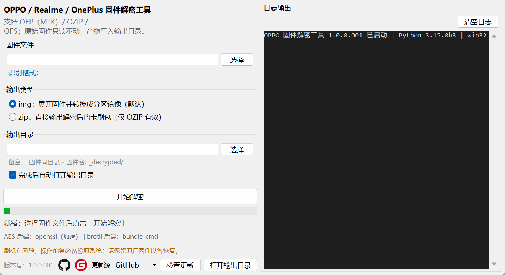

# OPPO 固件解密工具（OPPO / Realme / OnePlus Firmware Decrypt）

从 [mtk-garbage-porttool](https://github.com/LJY-33684/mtk-garbage-porttool-master) 中抽出的独立解密工具：
只做一件事 —— 把 OPPO 系固件解开，得到分区镜像或标准卡刷包。

- 版本：**1.0.0.001**
- 仓库：https://github.com/LJY-33684/oppo-firmware-decrypt
- 支持格式：**OFP（MTK）/ OZIP（Realme / OPPO）/ OPS（OnePlus）**
- 平台：Windows x64（主），Linux 可运行（需系统自备 openssl / brotli）
- Python：3.10+（已在 3.15 上完成 15/15 自检；3.13 可运行核心与 CLI，GUI 需完整 Tcl/Tk 数据）
- 许可：GPL-3.0（解密算法源自 B. Kerler 的 MIT 组件，见 `docs/THIRD_PARTY_NOTICES.md`）

## 快速开始

### 图形界面

双击 `run.bat`；若默认 `python` 缺少 Tcl/Tk（精简运行时常见），脚本会自动改用
`py -3` 或官方 Python 3.15 启动并提示实际解释器。也可以直接：

```bash
python main.py
```

界面只有四项：选固件 → 选输出类型 → 选输出目录 → 开始解密；右侧是实时日志，
完成后可直接打开输出目录。已声明 Per-Monitor V2 DPI 感知，125% / 150% / 200%
缩放下文字不会发糊，窗口尺寸按当前屏幕自适应。底部保留移植工具同款橙色风险提示
「刷机有风险，操作前务必备份原系统；请保留原厂固件以备恢复。」，版本号旁有 GitHub / Gitee 图标，
点击用系统浏览器打开对应仓库页；同一目录只运行一个 GUI 实例，重复启动会提示并可跳转回已运行窗口。



### 命令行

```bash
# 默认：展开固件并转换成分区镜像
python decrypt_cli.py decrypt --input RMX1901_11.A.20_OTA.ozip

# 直接输出解密后的卡刷包（仅 OZIP 有效，不展开）
python decrypt_cli.py decrypt --input RMX1901_11.A.20_OTA.ozip --out-type zip

# 指定输出目录 + 落盘日志
python decrypt_cli.py decrypt --input firmware.ofp --outdir D:\out\op7 --log-file D:\out\op7.log

# 版本号
python decrypt_cli.py --version
```

完整参数、退出码与集成约定见 [`docs/INTERFACE.md`](docs/INTERFACE.md)。

## 输出约定

| 项 | 规则 |
|---|---|
| 默认输出目录 | 与固件同级的 `<固件名>_decrypted/`；该目录已存在且非空时追加 `_YYYYMMDD-HHMMSS`，不覆盖旧产物 |
| 临时目录 | `<输出目录>/.oppo_decrypt_tmp/`，解密结束（成功或失败）自动清理 |
| 原始固件 | 只读不动，任何情况下都不修改源文件 |
| OFP / OPS | 始终输出分区镜像（这两种格式没有卡刷 zip 形态） |
| OZIP + img | 解密 → 展开 → `*.new.dat[.br]` 转 `*.img`，中间文件（`.br/.dat/transfer.list/patch.dat`）在转换成功后清理 |
| OZIP + zip | 只重建卡刷包，不展开、不转换，适合直接拿去刷机 |
| OZIP 明文包 | `boot.img` 未加密的旧包会被识别为「无需解密」，原样复制为 zip |

## 目录结构

仓库根目录只放 `README.md`、`LICENSE`、`.gitignore`、`latest_version.txt`，
源码全部在本子目录 `oppo-firmware-decrypt/` 内（发行 zip 的根目录即此目录）。

```
oppo-firmware-decrypt/（源码子目录）
├─ main.py                  GUI 启动入口（双击 run.bat 或 python main.py）
├─ decrypt_cli.py           CLI 入口（外部壳调用，接口契约不变）
├─ run.bat                  Windows 启动脚本（自动挑选带 Tcl/Tk 的 Python）
├─ app/                     全部实现与随包资源（一个包收口）
│  ├─ __init__.py
│  ├─ gui.py                轻量 Tk 界面（Per-Monitor V2 DPI 感知）
│  ├─ singleton.py          单实例锁（跳转已运行窗口 / 清除残留锁）
│  ├─ icons/                窗口图标 app.ico/app.png + GitHub / Gitee 图标
│  ├─ updater.py            更新检查模块（地址暂空，见下）
│  ├─ common.py             CLI/GUI 共用（默认输出目录等）
│  ├─ version.py            版本号唯一真源
│  ├─ core/                 解密核心包
│  │  ├─ oppo_decrypt.py    统一入口 decrypt() / detect_format()
│  │  ├─ fsutil.py          从上游 utils.py 摘出的 _clear_attrs / _rmtree
│  │  ├─ brotli.py          new.dat.br 解压（多后端探测）
│  │  ├─ sdat2img.py        new.dat + transfer.list → img
│  │  ├─ pyaes/             纯 Python AES 兜底
│  │  └─ _vendor_brotli/    内置 brotli Python 库（cp312–cp315 × win/manylinux）
│  ├─ bin/win/x86_64/       openssl.exe + libeay32.dll + ssleay32.dll + brotli.exe
│  ├─ licenses/             OpenSSL / Brotli 许可原文
│  ├─ tests/selftest.py     合成样本自检（15 项）
│  └─ tools/                构建与组件脚本
│     ├─ build_zip.py       发行 zip 打包脚本
│     ├─ 获取openssl加速组件.bat
│     └─ 获取brotli解压组件.bat
├─ docs/                    INTERFACE.md（CLI 契约）/ THIRD_PARTY_NOTICES.md（第三方声明）
├─ README.md                本文件
└─ LICENSE                  GPL-3.0 全文
```

## 解密后端

| 用途 | 优先顺序 | 说明 |
|---|---|---|
| AES | `app/bin/win/x86_64/openssl.exe` → 系统 `openssl` → 内置 `pyaes` | openssl 快很多；缺失时自动降级 pyaes，功能不变、速度变慢，日志会明确提示 |
| brotli（仅 img 模式解 `.new.dat.br`） | 自带 `brotli.exe` → 内置 vendor 库 → 系统 `brotli` → `pip install brotli` / `brotlicffi` | 全缺失时只影响 `.br` 解压，`.br` 原文件保留，boot/firmware 等镜像不受影响 |

`openssl.exe` 实测只需 `libeay32.dll` + `ssleay32.dll` 两个依赖（PE 导入表已核对），
不需要 `cygwin1.dll`；`brotli.exe` 依赖系统 VC 运行库，缺失时会自动回落到内置 Python 库。

## 自检

```bash
python app/tests/selftest.py
```

用合成样本覆盖：AES 双后端一致性、brotli 解压、sdat2img 转换、格式识别、
加密 OZIP 全链路、明文 OZIP、OFP 分区导出、OPS settings.xml 解密（MBox5）、
CLI 契约、更新模块未配置行为、GUI 构建与端到端解密。
无 Tcl/Tk 的 Python 会自动跳过 GUI 两项并标注 SKIP。

## 更新检查

`app/updater.py` 复用自 mtk-garbage-porttool：网络请求、`latest_version.txt` 解析、
发行说明 markdown 渲染、GUI 弹窗全部保留。**当前 `UPDATE_SOURCES` 的地址为空，
`UPDATE_ENABLED = False`**，点击「检查更新」只会提示「更新源尚未配置」，不会发任何网络请求。
GitHub 仓库已创建；发布 Release 资产后，填入 raw / api 地址并把开关改为 `True` 即可启用，其余逻辑无需改动。
`latest_version.txt` 已按版本号 1.0.0.001 预置在仓库根目录，发布时补上两个下载地址即可。

## 已知边界

- 仓库内不带真实固件样本（体积与版权原因）；发布前建议用真实 OFP / OZIP / OPS 各跑一遍，
  合成样本只能证明算法链路，不覆盖各家机型的密钥表差异。
- OFP 解密沿用上游实现：每个分区以「加密首块（`enclength > 0`）+ 明文余下部分」布局读取，
  与真实 OFP 一致；若遇到首块未加密的私有打包，需另做适配。
- 内置 `openssl.exe` 为 1.0.2u（Windows x64 构建），仅用于解密加速；
  其许可与 GPL-3.0 存在历史争议，介意可删除该组件，工具会自动降级 pyaes。
- Linux 下 `app/bin/win` 不可用，需系统安装 `openssl` 与 `brotli`（或 `pip install brotli`）。
- GUI 只暴露解密必需项，不含移植方案表、自动更新弹窗；单实例锁与仓库图标已保留。

## 致谢与许可

解密算法来自 [bkerler/OPPO_Decrypt_Tools](https://github.com/bkerler/OPPO_Decrypt_Tools)
（经 [ColdWindScholar/TIK](https://github.com/ColdWindScholar/TIK) 集成），
原版权行保留在 `app/core/oppo_decrypt.py` 文件头。本项目整体以 GPL-3.0 发布，
第三方组件许可见 [`docs/THIRD_PARTY_NOTICES.md`](docs/THIRD_PARTY_NOTICES.md)。
